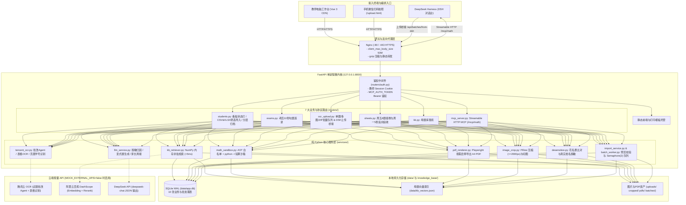
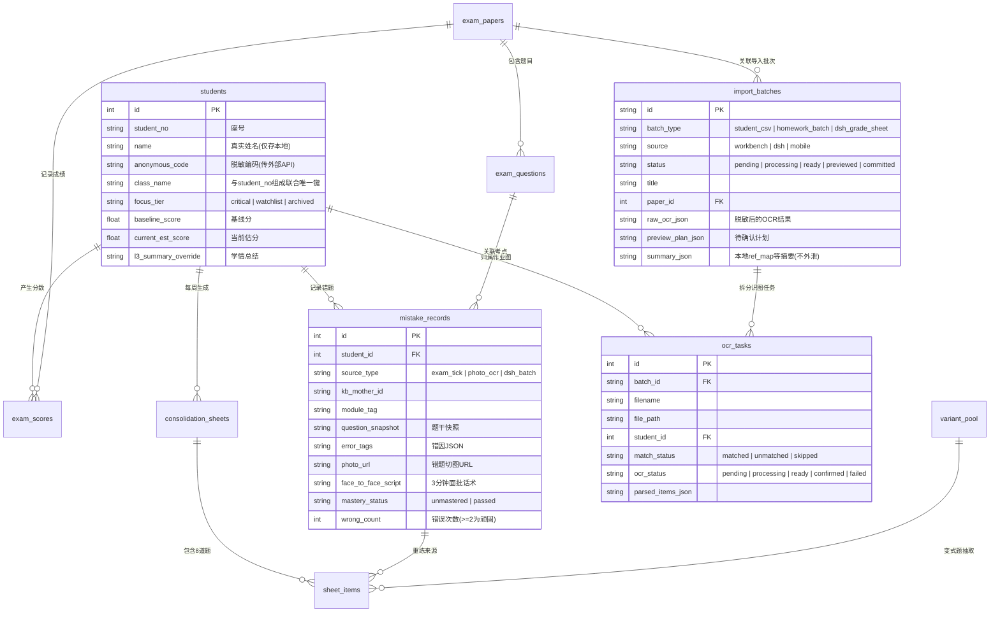
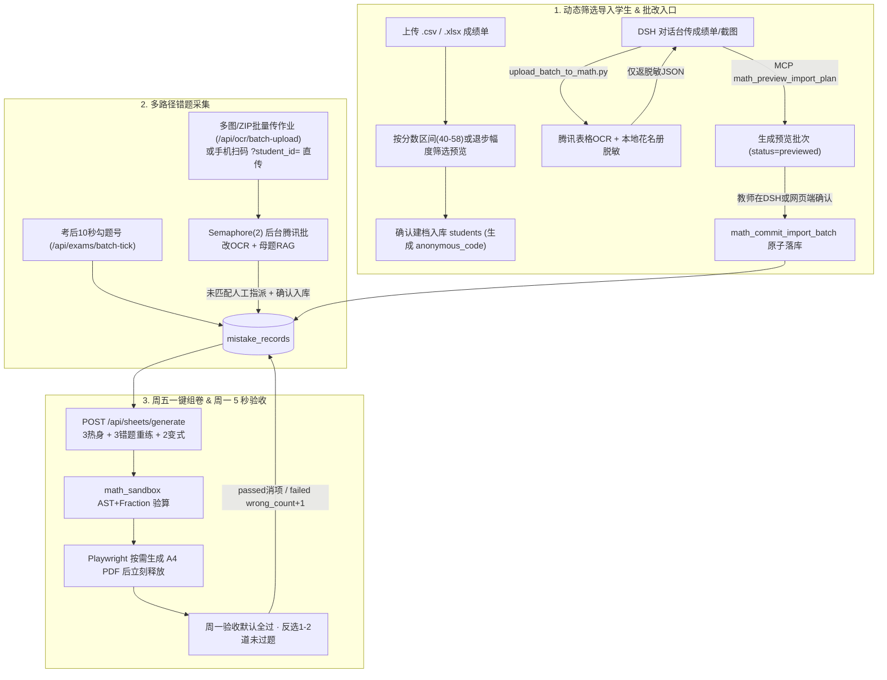

# 小学六年级数学“保及格”教师端工作台 · 工程架构与业务全景文档

> **项目目标**：专攻小学六年级 **40–58 分临界生**，通过“动态筛人 → 错题建档 → 周五出卷 → 周一验收”闭环稳拿基础分、冲刺 **65–70 分**。  
> **运行形态**：纯 Python 单进程 FastAPI 微内核 + SQLite WAL + 免打包 Vue 3 CDN 前端，支持与外部 **DeepSeek Harness (DSH)** 通过 Streamable HTTP MCP 联动批处理。

---

## 1. 整体系统架构图

---

## 2. 核心文件职责明细表

| 层次 / 目录 | 文件路径 | 职责与技术说明 |
| :--- | :--- | :--- |
| **配置** | `backend/config.py` | 管理 `MOCK_EXTERNAL_APIS`、`SEED_DEMO_DATA`、`MCP_AUTH_TOKEN`、密钥与目录路径。 |
| **数据库** | `backend/db.py` | 初始化 SQLite WAL 与 10 张表；为 `(class_name, student_no)` 建唯一索引；按开关控制演示数据注入。 |
| **数据契约** | `backend/schemas.py` | 定义学生导入预览/提交、批量 OCR、DSH 计划校验、组卷与验收全部 Pydantic 模型。 |
| **鉴权** | `backend/routers/auth.py` | 提供教师 Session Cookie 验证与恒定时间比对的 `MCP_AUTH_TOKEN` Bearer 鉴权。 |
| **学生与导入** | `backend/routers/students.py` | 看板状态灯（排除 `archived`）、`.csv`/`.xlsx` 解析筛选预览、提交建档、层级切换、DSH 批次核对。 |
| **考后录错** | `backend/routers/exams.py` | 键盘连录成绩与错题号；加权更新 `current_est_score`，重复出错自动递增 `wrong_count`。 |
| **OCR与批处理** | `backend/routers/ocr_upload.py` | 支持单图/手机带 `student_id` 直传、多图与 `.zip` 批量入队、人工指派学生及 `/api/batches/from-dsh` 桥接。 |
| **巩固单** | `backend/routers/sheets.py` | 固定“3热身 + 3错题重练 + 2变式”8题组卷，调用沙箱验算与 Playwright 合并导出 A4 PDF；支持周一 5 秒验收。 |
| **MCP服务** | `backend/routers/mcp_server.py` | 暴露 `/mcp/math` Streamable HTTP 接口（7 个工具），供 DSH 在脱敏约束下查询、预览与确认写库。 |
| **脱敏服务** | `backend/services/desensitize.py` | 解析 CSV/XLSX、本地匹配学生花名册、将真实姓名替换为 `anonymous_code` 或 `cand_xxx`、文件名匹配学生。 |
| **导入编排** | `backend/services/import_service.py` | 统一承载 CSV 筛选预览、DSH 导入计划 Pydantic 校验、原子写入 `students`/`exam_scores`/`mistake_records`。 |
| **异步队列** | `backend/services/batch_worker.py` | 以 `asyncio.Semaphore(2)` 并发限流执行批量作业 OCR 与页眉学号匹配，防止低配机器 OOM。 |
| **母题检索** | `backend/services/kb_retriever.py` | NumPy 矩阵点积计算余弦相似度 + 领域关键词加权，内存约 0.5 MB，召回耗时约 1–2 ms。 |
| **算术沙箱** | `backend/services/math_sandbox.py` | `ast.parse` 静态白名单封禁危险调用，`python -I` 子进程 2 秒超时执行 `Fraction` 等价性验算。 |
| **PDF渲染** | `backend/services/pdf_renderer.py` | 仅出卷时拉起 headless Chromium 渲染 `print_sheet.html` 为 A4 PDF，生成后立刻 `close()` 释放内存。 |
| **前端工作台** | `frontend/index.html`、`frontend/static/app.js` | 免打包 Vue 3 单页应用，涵盖看板、筛选导入弹窗、DSH 核对、批量作业队列、印卷与周一验收抽屉。 |
| **DSH 接入包** | `deploy/dsh/` | 包含附件上传桥接脚本 `upload_batch_to_math.py` 与 `grade6-math-intake/SKILL.md` 操作约束规范。 |

---

## 3. 数据库 10 张核心表关系模型

---

## 4. 核心业务闭环流程

---

## 5. 多设备开发与跨服务器迁移约定

1. **多设备共享源码**：所有架构与部署规范收敛在 `README.md`、`PROJECT_STRUCTURE.md`、`DEPLOY_AND_DSH.md`，本地修改后务必运行 `python scripts/verify_e2e.py` 通过再推送 GitHub；禁止将 `.env` 与 `data/` 下运行数据提交至仓库。
2. **业务数据 10 秒迁移**：全部业务状态集中在 `data/app.db` 及 `data/uploads/`、`data/cropped/`、`data/pdfs/`、`data/batches/`，打包 `data/` 即可无缝迁移至新服务器。
