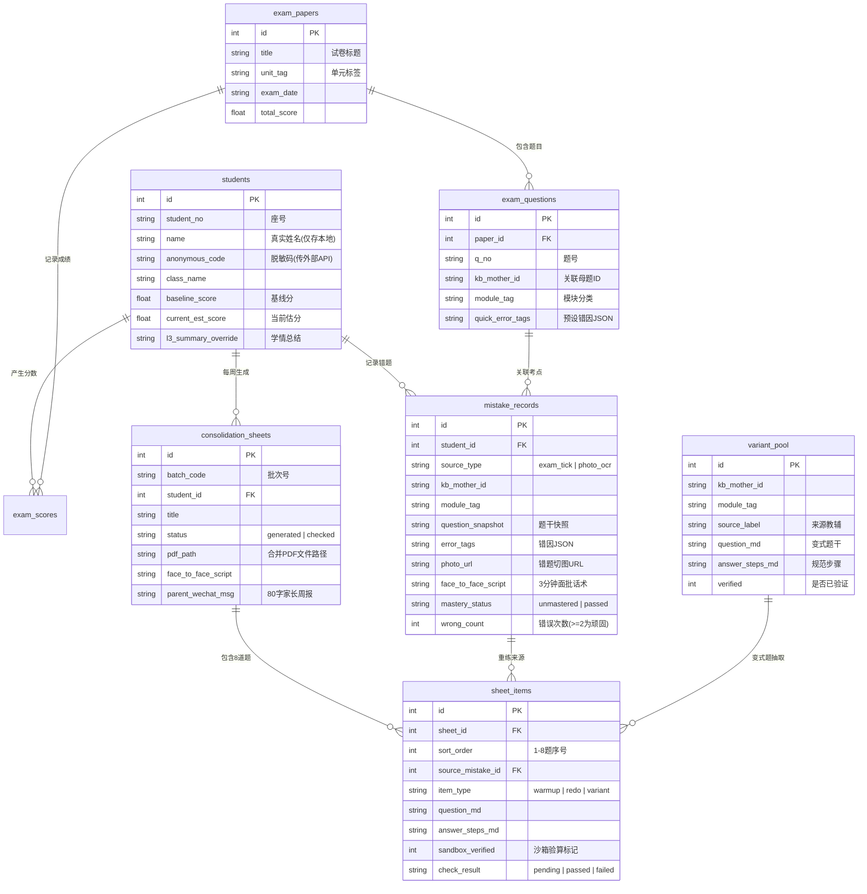

# 小学六年级数学“保及格”教师端工作台 · 工程架构与目录设计全景文档

> **项目目标**：专攻小学六年级 **40–58 分临界生**，目标稳拿基础分冲刺 **65–70 分及格线**。  
> **运行环境**：专为 **2核 2 GiB 内存、40 GiB 硬盘的 Ubuntu 22.04 服务器（如阿里云 99元/年款）** 定制开发。  
> **核心指标**：生产常驻内存 **67.22 MB**（严格处于 250–350 MB 安全红线内），0 容器负担，支持本地开箱即跑与云端一键平移。

---

## 1. 整体系统架构图

```mermaid
flowchart TD
    subgraph 接入终端 [前端多端交互]
        A1["教师电脑浏览器 (/index.html)"]
        A2["手机微信扫码直传 (/upload.html)"]
    end

    subgraph 网络层 [反向代理与安全接入]
        B["Nginx (:80 / :443 HTTPS)\n- client_max_body_size 20M\n- gzip加速传输"]
    end

    subgraph 后端微内核服务 [FastAPI 单进程服务 (127.0.0.1:8000 常驻内存 ~67MB)]
        C1["Session 鉴权与 Cookie 中间件 (routers/auth.py)"]
        C2["静态前端托管 (Vue 3 + Tailwind + KaTeX CDN)"]
        
        subgraph 业务路由层 [5 大核心业务接口 (routers/)]
            R1["临界生看板与四板块状态灯 (students.py)"]
            R2["考后 10 秒勾题号连录 (exams.py)"]
            R3["作业拍照批改与 2 秒确认卡 (ocr_upload.py)"]
            R4["周五一键出卷与周一 5 秒反向验收 (sheets.py)"]
            R5["真题母题资源库查阅与检索 (kb.py)"]
        end

        subgraph 后台核心服务 [6 大轻量基础服务 (services/)]
            S1["极简内存 RAG 检索器 (kb_retriever.py)\nNumPy 余弦相似度 0.4ms 召回"]
            S2["原生隔离算术沙箱 (math_sandbox.py)\nAST 静态白名单 + fractions 验算"]
            S3["按需临时渲染引擎 (pdf_renderer.py)\nPlaywright Chromium 导出完即 Close"]
            S4["手写作业智能切图 (image_crop.py)\nPillow 限制长边 2000px 自动压缩"]
            S5["腾讯云批改 Agent 封装 (tencent_ocr.py)"]
            S6["DeepSeek 错因归因与出题 (llm_service.py)"]
        end
    end

    subgraph 本地持久化资产 [纯本地存储资产 (data/ 10秒可打包平移)]
        D1[("SQLite 数据库 (app.db WAL模式)\n8 张业务核心数据表")]
        D2["母题预存向量索引 (kb_vectors.json <1MB)"]
        D3["原题扫描大图 (data/exam_scans/ 16张超清图)"]
        D4["作业原图与切图 (data/uploads/, data/cropped/)"]
        D5["合并 A4 PDF 文件池 (data/pdfs/)"]
    end

    subgraph 云端外包服务 [按量轻量 API (支持 MOCK_EXTERNAL_APIS=true 离线运行)]
        E1["腾讯云试题批改 Agent (YouTu 修正模型)"]
        E2["阿里云百炼 DashScope (Embedding + Rerank)"]
        E3["DeepSeek API (deepseek-chat JSON 格式输出)"]
    end

    A1 -->|HTTP/HTTPS| B
    A2 -->|HTTP/HTTPS| B
    B --> C1
    C1 --> C2
    C1 --> R1 & R2 & R3 & R4 & R5
    R1 & R2 & R3 & R4 & R5 --> S1 & S2 & S3 & S4 & S5 & S6
    S1 & S2 & S3 & S4 & S5 & S6 --> D1 & D2 & D3 & D4 & D5
    S1 -.->|真实模式切换| E2
    S5 -.->|真实模式切换| E1
    S6 -.->|真实模式切换| E3
```

---

## 2. 完整目录树形结构

```text
grade6-math-lite/
├── .env.example                     # 环境变量模板（默认 MOCK_EXTERNAL_APIS=true 开箱即跑）
├── .env                             # 本地实际环境变量（自动加载）
├── .gitignore                       # Git 忽略配置（忽略 db-wal、uploads 等临时文件）
├── README.md                        # 本地极速启动与云端运维手册
├── PROJECT_STRUCTURE.md             # 本架构全景设计说明文档
├── requirements.txt                 # 精简 Python 依赖清单（无重型向量库与模型）
│
├── knowledge_base/                  # 六年级核心母题 Markdown 种子库（带 YAML Frontmatter）
│   ├── G6-CALC-01-分数四则混合运算与简便计算.md
│   ├── G6-FRAC-01-找准单位1求部分量与总量.md
│   ├── G6-RATIO-01-比的基本性质与按比分配.md
│   └── G6-GEO-01-圆的周长与面积基础应用.md
│
├── scripts/                         # 自动化运维与质检脚本
│   ├── build_kb.py                  # 母题离线建库脚本（Markdown -> data/kb_vectors.json）
│   └── verify_e2e.py                # 端到端 6 大核心闭环自动化测试验收脚本
│
├── deploy/                          # 2核2G 生产环境高可用部署包
│   ├── init_ubuntu_2g.sh            # 阿里云 Ubuntu 22.04 一键初始化与 2G Swap 设置脚本
│   ├── grade6-math.service          # systemd 守护进程与内存限制配置文件
│   └── nginx_site.conf              # Nginx 20M 反向代理与 HTTPS 配置模板
│
├── backend/                         # 后端 Python 微内核核心源码
│   ├── __init__.py
│   ├── main.py                      # FastAPI 主入口、生命周期控制、静态资源与前端挂载
│   ├── config.py                    # 基于 Pydantic Settings 的环境变量强类型配置
│   ├── db.py                        # SQLite WAL 初始化、建表与 5 名演示临界生预置
│   ├── schemas.py                   # Pydantic 请求与响应数据结构定义
│   │
│   ├── routers/                     # RESTful API 路由模块
│   │   ├── auth.py                  # 教师单密码登录、Session Cookie 校验与登出
│   │   ├── students.py              # 临界生总览看板、四板块状态灯、单生档案追踪
│   │   ├── exams.py                 # 试卷信息绑定 + 考后 10 秒勾题号连录接口
│   │   ├── ocr_upload.py            # 手机/电脑作业拍照上传 + 腾讯云批改 + 2秒确认卡
│   │   ├── sheets.py                # 周五一键组卷导出 A4 PDF + 周一 5 秒反向验收
│   │   └── kb.py                    # 教师端母题资源库在线查阅与搜索接口
│   │
│   └── services/                    # 纯 Python 轻量服务层
│       ├── kb_retriever.py          # 极简内存 RAG（NumPy 余弦相似度检索，耗时 < 1ms）
│       ├── math_sandbox.py          # 原生隔离算术沙箱（AST 白名单 + fractions 验算）
│       ├── pdf_renderer.py          # 按需唤醒 PDF 渲染器（Playwright 导出完即销毁释放）
│       ├── image_crop.py            # Pillow 图像裁剪与长边 2000px 自动无损压缩
│       ├── tencent_ocr.py           # 腾讯云试题批改 Agent 异步轮询与结果解析封装
│       └── llm_service.py           # DeepSeek 出变式、错因归因与家长周报封装
│
├── frontend/                        # 免构建轻量全栈前端（Vue 3 CDN，零 Node/Webpack）
│   ├── login.html                   # 教师端访问密码登录页
│   ├── index.html                   # 教师工作台单页（总览看板/极速录错/单生追踪/印卷/母题）
│   ├── upload.html                  # 手机端微信扫码极简拍照直传页
│   └── static/
│       ├── app.js                   # 前端 Vue 3 核心交互逻辑与快捷键处理
│       └── print_sheet.html         # 严格一人一页 A4 巩固单打印排版模板（Jinja2+KaTeX）
│
└── data/                            # 运行期持久化存储（打包此目录即可 100% 迁移数据）
    ├── app.db                       # SQLite 核心业务数据库文件
    ├── kb_vectors.json              # 母题内存预计算向量索引（< 1MB）
    ├── exam_scans/                  # 4 套历年期末真题拆解出的 16 页超清大图
    ├── uploads/                     # 手机/电脑上传的学生作业照片
    ├── cropped/                     # 批改 Agent 自动切出的单题错题图片
    └── pdfs/                        # 每周五生成的合并 A4 巩固单 PDF 文件
```

---

## 3. 核心文件职责明细表

| 层次 / 目录 | 文件路径 | 职责与技术说明 |
| :--- | :--- | :--- |
| **配置** | `backend/config.py` | 统一管理 `MOCK_EXTERNAL_APIS`、密钥与数据库路径，严禁任何代码内硬编码。 |
| **数据库** | `backend/db.py` | 开启 `WAL` 模式与外键约束；预置 5 名临界生、1 套单元卷与 4 道变式题。 |
| **数据契约** | `backend/schemas.py` | 定义前端与后端交互的输入/输出契约（入库、查卷、批量打勾、周一验收）。 |
| **鉴权路由** | `backend/routers/auth.py` | 单教师 Cookie Session 验证，拦截未授权访问保护学生隐私与 API 额度。 |
| **看板路由** | `backend/routers/students.py` | 计算四板块（计算/分数/比/几何）红黄绿状态灯、提取 Top3 错因与单生档案。 |
| **录错路由** | `backend/routers/exams.py` | 键盘焦点流驱动连录，自动累加 `wrong_count`，第 2 次出错自动标记为顽固错题。 |
| **OCR路由** | `backend/routers/ocr_upload.py` | 接收作业照片，启动批改并返回切图；默认仅勾选错题，2 秒扫一眼确认入库。 |
| **出卷路由** | `backend/routers/sheets.py` | 固定“3题热身 + 3题重练 + 2题变式”配方；驱动沙箱验算并调用 PDF 导出。 |
| **母题检索** | `backend/services/kb_retriever.py` | NumPy 矩阵点积计算余弦相似度，无需加载重量级向量数据库，检索耗时约 0.4ms。 |
| **算术沙箱** | `backend/services/math_sandbox.py` | `ast.parse` 静态封禁文件网络系统调用；子进程执行 `Fraction`，超时 2 秒即焚。 |
| **PDF渲染** | `backend/services/pdf_renderer.py` | 仅在出卷时临时启动 Playwright Chromium，生成完立刻 `close()`，常驻内存 0 MB。 |
| **前端工作台** | `frontend/index.html` | Tailwind + Vue 3 CDN 免打包单页应用，加载瞬时完成。 |
| **排版模板** | `frontend/static/print_sheet.html` | CSS 强制 `@page { size: A4; }`，每生独立 1 页留白 + 末页教师速查表。 |

---

## 4. 数据库 8 张核心表关系模型



---

## 5. 核心业务闭环流程

### 5.1 周中考后：10 秒勾题号极速录错（Tab A）
1. 老师选择本次测验卷，光标自动聚焦在“1 号学生分数框”；
2. 输入得分后按 `Tab` 键跳到大号题号矩阵 `[1]...[20]`；
3. 点击做错的题号（变红），展开预设高频错因胶囊点击多选；
4. 按 `Enter` 键毫秒级保存：
   - 首次出错：进入 `mistake_records`，`wrong_count = 1`；
   - 再次出错：系统自动定位未过关记录，`wrong_count + 1`，自动升级为红色角标**顽固错题**；
5. 光标自动切换至下一名临界生，全程无需鼠标点多余按钮。

### 5.2 周末出卷：一键导出 A4 巩固单与沙箱验算
1. 教师在总览看板勾选目标临界生（如 2–3 人），点击“一键生成本周巩固单”；
2. 后端执行**严格组卷配方**（每生 8 题）：
   - **第 1–3 题（L1 计算热身）**：乘法分配律口算/脱式/解简易方程；
   - **第 4–6 题（顽固错题精准重练）**：优先挑选该生 `wrong_count >= 2` 的历史错题；
   - **第 7–8 题（同源保底变式）**：从题池抽取或 LLM 出题，必须经 `math_sandbox.py` 子进程验算 `print(result) == expected_answer`（`sandbox_verified = 1`）方可入卷；
3. 调用 Playwright Chromium 临时渲染模板生成合并 PDF：
   - 每位学生固定占满 **1 页 A4**（留足 3–4 行竖式留白，`page-break-after: always`）；
   - 合并 PDF 末页输出《教师参考答案与 3 分钟面批话术速查表》；
   - 2 名学生导出 PDF **严格等于 3 页**。导出后 Playwright 立即退出，内存释放。

### 5.3 周一早自习：5 秒反向验收
1. 学生订正巩固单交回，老师点击该生“周一 5 秒验收”按钮；
2. 弹出 8 道题弹窗，**默认全部勾选为“已过关”**；
3. 老师扫一眼，仅把学生依然做错的 1–2 题取消勾选，点击提交；
4. 系统自动处置：
   - 勾选过关的题目：关联错题标记为 `passed`，成功消项；
   - 未过关的题目：关联错题 `wrong_count` 自动 `+1`，锁定至下周追踪库。

---

## 6. 本地运行与云端数据迁移

### 本地启动命令
```bash
cd grade6-math-lite
source .venv/bin/activate
python -m backend.main
```
浏览器打开：`http://127.0.0.1:8000`（访问密码：`math2026`）。

### 数据 10 秒平移至云服务器
因为数据完全收敛在 `data/` 目录且全采用相对路径：
```bash
# 本地打包
tar -czvf math_data_backup.tar.gz data/

# 上传到云服务器并解压
scp math_data_backup.tar.gz root@服务器IP:/opt/grade6-math-lite/
ssh root@服务器IP "cd /opt/grade6-math-lite && tar -xzvf math_data_backup.tar.gz && systemctl restart grade6-math"
```
数据平移即刻生效，无需任何数据库重构操作！
